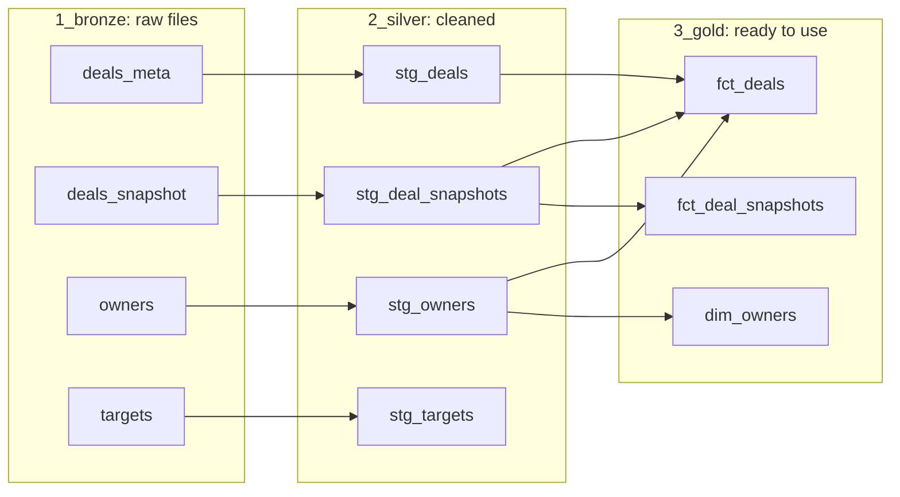

# Innovatech RevOps

This repository answers three questions from the CRO:

1. Why did the Q1 forecast miss the target by 18%?
2. Where are deals stalling, and why?
3. Given today's pipeline, are we on track for next quarter?

It was built with DBT plus DuckDB as the data architecture. The data is organised as a star schema (one table of sales reps and two fact tables of deals) and goes through the medallion layers (bronze, silver and gold). It includes data-quality flags for the messy CRM data, checks that tie the results back to the source files, and an executive summary with charts.

To run it yourself and look at the data, jump to [Get started](#get-started-how-to-access-the-data).

## What this project answers

### 1. We missed Q1 bookings by 18%. What blew the forecast?

The forecast was small (75% of the target) and nearly half of it never closed: $354k of its $871k reached its close date and was left open.


### 2. Where are deals stalling, and why?

In every stage, not in one. Deals reach their close date without a decision in Prospecting, Qualification, Proposal and Negotiation, and nobody closes them. Cleaning them up shows the real pipeline, but more pipeline is what adds revenue.


### 3. Given today's pipeline, are we on track for next quarter?

No. Open pipeline is $1.74M, under half the usual level, and 44% of it belongs to reps who have left.


Full answers, numbers and next steps: [Executive summary](docs/executive_summary.md).

## How the data is organised

The raw sales data goes through three steps. Each step has its own section (a "schema") in the database, numbered so they list in order.

| Step | Schema | In plain words |
|---|---|---|
| 1 | `1_bronze` | The four original files, loaded as they are |
| 2 | `2_silver` | The same data cleaned up: clearer names, personal data (emails) removed, problems flagged |
| 3 | `3_gold` | Ready to use: sales reps, deals and weekly snapshots |

The four original files are deals, weekly pipeline snapshots, sales reps and targets. They are in `seeds/`.

### The ready-to-use tables

| Table | What it is |
|---|---|
| `dim_owners` | The dimension: one row per sales rep, and whether they are still in the company |
| `fct_deals` | A fact table: one row per deal, with its history added (furthest stage, weeks per stage, how it stands today) |
| `fct_deal_snapshots` | A fact table: one row per deal per week, with flags for the start-of-quarter forecast and the pipeline reading before each quarter |

Both fact tables carry `owner_id`, the key to `dim_owners`.

The three questions are not tables. They are short queries in `analyses/`, which you can paste into the DuckDB browser:

| Question | Query |
|---|---|
| 1. Why Q1 missed | `q1_forecast.sql` |
| 2. Where deals stall | `q2_where_deals_stall.sql` |
| 3. Is Q3 on track? | `q3_pipeline_before_quarter.sql` (history), `q3_live_pipeline.sql` (today) and `q3_deals_to_check.sql` (deals for Finance to confirm) |

### How the tables connect

Each arrow means "is built from". Read left to right: raw files, cleaned, ready to use.



To see this diagram with a description of every column, follow step 3 in [Get started](#get-started-how-to-access-the-data).

## Terms used

| Term | Meaning |
|---|---|
| Today / as-of date | 9 June 2025, the last weekly snapshot we have |
| Bookings | The value of deals that are Closed Won, counted in the quarter of their close date |
| Forecast | Deals that were Commit, Best Case or already won at the start of the quarter, and due to close in it |
| Starting pipeline | Open deals due in a quarter, measured on the last weekly snapshot at least 3 weeks before it starts |
| Left open | A deal still open after its close date, never marked won or lost |
| Live pipeline | Open deals whose close date is still ahead |
| Orphaned deal | An open deal whose owner has left the company |
| Target | About $1.16M a quarter, worked back from the 18% Q1 miss. The targets file is overestimated (see below) |

## Checks

- Every table has checks on its keys and allowed values: 55 checks in total.
- Two checks tie the results back to the original data: total bookings must equal the Closed Won amounts in the source file, and no deal or weekly snapshot may be lost between the raw files and the ready-to-use tables.
- Four checks are warnings on purpose. They point to the data problems below without stopping the build: target growth, forecast ahead of stage, deals won early, and deals created under reps who left.

## Folder guide

| Folder | Contents |
|---|---|
| `seeds/` | The four original files |
| `models/silver/` | Step 2 (cleaning) |
| `models/gold/` | Step 3 (ready-to-use tables) |
| `analyses/` | The queries that answer the three questions. They are plain SQL, so they can be pasted into the DuckDB browser |
| `tests/` | The checks that tie results back to the source |
| `scripts/` | Draws the charts used in the executive summary |
| `docs/` | Executive summary (with its charts in `docs/charts/`) |

## Problems found in the data

| Problem | What we found | How it is handled |
|---|---|---|
| Targets overestimated | In Q2 2024 targets jump 1.75–6.15 times, and from Q3 2024 each rep's target is exactly 6.15 times the last, reaching $589M for Q1 2025 against about $1M booked | Flagged (`is_target_plausible`); a realistic target of $1.16M is used instead |
| Deals left open | 387 deals ($21.8M) are past their close date but still open | Marked as "left open" and left out of live pipeline |
| Won in bulk | On 9 June, 17 deals jumped to Won 8–141 days before their close date. Before that, no deal was marked won more than 6 days early | Flagged (`is_won_well_before_close`); not counted as wins in the win rates; listed for Finance in `q3_deals_to_check.sql` |
| Deals under reps who left | 22 deals were created under two reps after their end date | Flagged (`is_created_by_inactive_owner`) |
| Forecast ahead of stage | 6 deals are in Commit or Best Case too early in the process | Flagged (`is_forecast_ahead_of_stage`) |
| No new deals for 3 months | The last deal before August was created on 8 May, and 50 deals appear in August | Not fixed. Possibly a gap in the export, to confirm |
| Data after the last snapshot | The 50 deals created in August 2025 have no history | Flagged (`is_created_after_as_of`); left out of the stall, forecast and pipeline analyses |
| CRM ahead of the snapshot | 3 deals have one snapshot and a later stage in the CRM | Kept. Stage reached comes from the snapshots |
| Personal data | Rep email addresses | Removed in step 2 |

## Assumptions

Where the data does not say, the project makes a choice. These are all of them.

| Assumption | Where | If it is wrong |
|---|---|---|
| Today is 9 June 2025, the last snapshot. The date is typed in by hand | `as_of_date` in `dbt_project.yml`. The analyses use the last snapshot date | New weekly data needs the date updated, or the flags describe an older day |
| Quarters are calendar quarters (Q1 is January to March) | `stg_targets`, and `date_trunc('quarter')` in the other models | Quarter labels shift, and the targets, forecasts and readings follow |
| The Q1 target is about $1.16M, worked back from the CRO's 18% miss. Q3 uses the same number | `MISS` in `scripts/build_charts.py` and the executive summary | Every "% of target" changes. The conclusions do not |
| A target that grows more than 50% in one quarter is unrealistic | `is_target_plausible` in `stg_targets` | Only changes the warning |
| A rep whose end date is the as-of date has already left | `is_active_as_of` in `stg_owners` | Changes who owns "orphaned" deals only if an end date equals the as-of date. None does today |
| The forecast is the first snapshot of a finished quarter: deals due in it that are Commit, Best Case or already won | `is_forecast_call` in `fct_deal_snapshots` | Changes the forecast size in question 1 |
| The starting pipeline is the last snapshot at least 21 days, and at most 35 days, before the quarter | `reading_points` in `fct_deal_snapshots` | Changes the pipeline in question 3. Today the readings are 21–23 days before |
| Won more than 6 days before the close date is out of pattern. Before 9 June the largest gap was 6 days | `is_won_well_before_close` in `fct_deals` | Changes which deals are for Finance to check and the win rates |
| A deal left open counts as not won in the win rates | `win_rates` in `q3_live_pipeline` | Win rates and the low end of the Q3 estimate go up |
| The furthest stage and weeks per stage come from the weekly snapshots | `fct_deals`, `q2_where_deals_stall` | A fast deal can skip a stage, so some wins show in an early stage |
| Bookings per pipeline dollar uses all the quarter's bookings, including deals created in the quarter | `q3_pipeline_before_quarter` | The high end of the Q3 estimate assumes new deals keep arriving as usual |
| The first reading (Q2 2024) is left out of the average, because the data starts in January 2024 | Executive summary | The average would be 32 cents, not 29 |

## Get started: how to access the data

The database is built on your computer and is not stored on GitHub. Run every command below in the main folder of the project (`innovatech-revops`).

### Step 1. Set up (once)

```bash
python -m venv revops
source revops/bin/activate
pip install dbt-duckdb
```

In every new terminal window, run `source revops/bin/activate` again before using `dbt`.

### Step 2. Build the database

```bash
dbt build
```

`dbt build` loads the four files, builds every table and runs all the checks. A few warnings at the end are expected: they point to the data problems listed above. The database is created as `innovatech.duckdb`.

### Step 3. Look at the data

**See the tables in your browser:**

```bash
python -c "import duckdb; c = duckdb.connect('innovatech.duckdb'); c.sql('CALL start_ui()'); input('Open http://localhost:4213 (press Enter to stop)')"
```

Open http://localhost:4213. On the left, open `innovatech`, then `3_gold`, and click a table. To see its rows, write a query:

```sql
select * from "3_gold".fct_deals;
```

Schema names start with a number, so put quotes around them in SQL. To see an answer to one of the three questions, open a file in `analyses/`, paste it into the browser and run it.

DuckDB lets only one program use the database at a time. Press Enter in the terminal to stop the browser **before you run any `dbt` command**, or DBT will fail with `Could not set lock on file`.

**See how the tables connect, with every column explained.** Stop the browser first, then:

```bash
dbt docs generate
dbt docs serve
```

A page opens at http://localhost:8080. Click the round button at the bottom right to see the diagram. Press Ctrl+C in the terminal to stop it.

**Redraw the charts** after the data changes:

```bash
python scripts/build_charts.py
```
