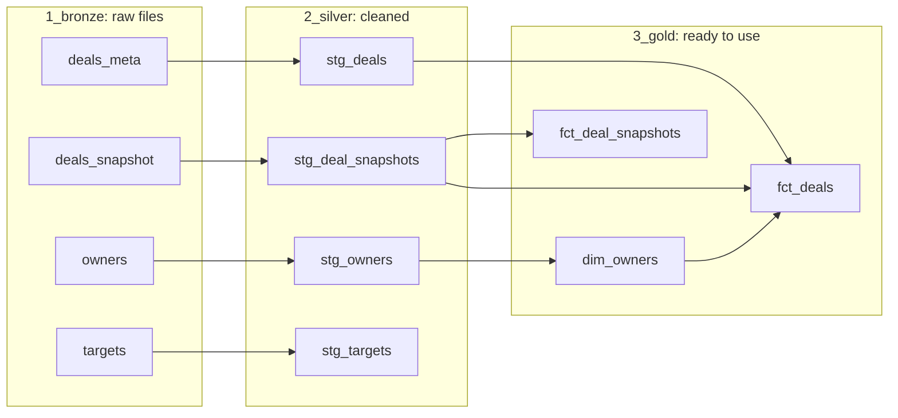

# Innovatech RevOps

dbt + DuckDB analytics case for a CRO: why the Q1 forecast missed by 18%, where deals stall, and whether next quarter is on track. Medallion layers (bronze, silver, gold), data-quality flags on messy CRM data, reconciliation tests, and an executive summary with charts.

To run it yourself and look at the data, jump to [Get started](#get-started-how-to-access-the-data).

## What this project answers

### 1. We missed Q1 bookings by 18%. What blew the forecast?

The forecast was too small, and its deals were never closed out: $354k of the $871k forecast reached its close date and was left open.


### 2. Where are deals stalling, and why?

At the start. Deals that don't leave Prospecting sit there until their close date passes, and nobody closes them.


### 3. Given today's pipe, are we on track for next quarter?

No. Open pipeline is under half the usual level, and 44% of it belongs to reps who have left.


Full answers, numbers and next steps: [Executive summary](docs/executive_summary.md).

## How the data is organised

The raw sales data goes through three steps. Each step has its own section (a "schema") in the database, numbered so they list in order.

| Step | Schema | In plain words |
|---|---|---|
| 1 | `1_bronze` | The four original files, loaded as they are |
| 2 | `2_silver` | The same data cleaned up: clearer names, personal data (emails) removed, problems flagged |
| 3 | `3_gold` | Ready to use: sales reps, deals and weekly snapshots |

The four original files are deals, weekly pipeline snapshots, sales reps and targets. They are in `seeds/`.

### The ready-to-use tables

| Table | What it is |
|---|---|
| `dim_owners` | One row per sales rep, and whether they are still in the company |
| `fct_deals` | One row per deal, with its history added (furthest stage, weeks per stage, how it stands today) |
| `fct_deal_snapshots` | One row per deal per week, with flags for the start-of-quarter forecast and the pipeline reading before each quarter |

The three questions are not tables. They are short queries in `analyses/`, which you can paste into the DuckDB browser:

| Question | Query |
|---|---|
| 1. Why Q1 missed | `q1_forecast.sql` |
| 2. Where deals stall | `q2_where_deals_stall.sql` |
| 3. Is Q3 on track? | `q3_pipeline_before_quarter.sql` (history) and `q3_live_pipeline.sql` (today) |

### How the tables connect

Each arrow means "is built from". Read left to right: raw files, cleaned, ready to use.



To see this diagram with a description of every column, follow step 3 in [Get started](#get-started-how-to-access-the-data).

## Terms used

| Term | Meaning |
|---|---|
| Today / as-of date | 9 June 2025, the last weekly snapshot we have |
| Bookings | The value of deals that are Closed Won, counted in the quarter of their close date |
| Forecast | Deals that were Commit, Best Case or already won at the start of the quarter, and due to close in it |
| Left open | A deal still open after its close date, never marked won or lost |
| Live pipeline | Open deals whose close date is still ahead |
| Orphaned deal | An open deal whose owner has left the company |
| Q1 target | About $1.16M, worked back from the 18% miss, because the targets file is unusable (see below) |

## Problems found in the data

| Problem | What we found | How it is handled |
|---|---|---|
| Targets unusable | After Q1 2024, each quarter's target is exactly 6.15 times the last | Flagged; the Q1 2025 target is estimated instead |
| Deals left open | 387 deals ($21.8M) are past their close date but still open | Marked as "left open" and left out of live pipeline |
| Won in bulk | On 9 June, 15 deals jumped to Won 24–141 days before their close date. Before that, no deal was marked won more than 6 days early | Flagged for Finance to confirm |
| Deals under reps who left | 22 deals were created under two reps after their end date | Flagged |
| Forecast ahead of stage | 6 deals are in Commit or Best Case too early in the process | Flagged |
| Data after the last snapshot | 50 deals created in August 2025 have no history | Left out of the analysis |
| Personal data | Rep email addresses | Removed in step 2 |

## Checks

- Every table has checks on its keys and allowed values.
- Two checks tie the results back to the original data: total bookings must equal the Closed Won amounts in the source file, and no deal or weekly snapshot may be lost between the raw files and the ready-to-use tables.
- The data problems above show as warnings, so they are visible without stopping the build.

## Folder guide

| Folder | Contents |
|---|---|
| `seeds/` | The four original files |
| `models/silver/` | Step 2 (cleaning) |
| `models/gold/` | Step 3 (ready-to-use tables) |
| `analyses/` | The queries that answer the three questions |
| `tests/` | The checks that tie results back to the source |
| `scripts/` | Draws the charts used in the executive summary |
| `docs/` | Executive summary (with its charts in `docs/charts/`) |

## Get started: how to access the data

The database is built on your computer and is not stored on GitHub. Run every command below in the main folder of the project (`innovatech-revops`).

### Step 1. Set up (once)

```bash
python -m venv revops
source revops/bin/activate
pip install dbt-duckdb
```

In every new terminal window, run `source revops/bin/activate` again before using `dbt`.

### Step 2. Build the database

```bash
dbt build
```

`dbt build` loads the four files, builds every table and runs all the checks. A few warnings at the end are expected: they point to the data problems listed above. The database is created as `innovatech.duckdb`.

### Step 3. Look at the data

**See the tables in your browser:**

```bash
python -c "import duckdb; c = duckdb.connect('innovatech.duckdb'); c.sql('CALL start_ui()'); input('Open http://localhost:4213 (press Enter to stop)')"
```

Open http://localhost:4213. On the left, open `innovatech`, then `3_gold`, and click a table. To see its rows, write a query:

```sql
select * from "3_gold".fct_deals;
```

Schema names start with a number, so put quotes around them in SQL. To see an answer to one of the three questions, open a file in `analyses/`, paste it into the browser and run it.

DuckDB lets only one program use the database at a time. Press Enter in the terminal to stop the browser **before you run any `dbt` command**, or dbt will fail with `Could not set lock on file`.

**See how the tables connect, with every column explained.** Stop the browser first, then:

```bash
dbt docs generate
dbt docs serve
```

A page opens at http://localhost:8080. Click the round button at the bottom right to see the diagram. Press Ctrl+C in the terminal to stop it.

**Redraw the charts** after the data changes:

```bash
python scripts/build_charts.py
```
